<div align="center">

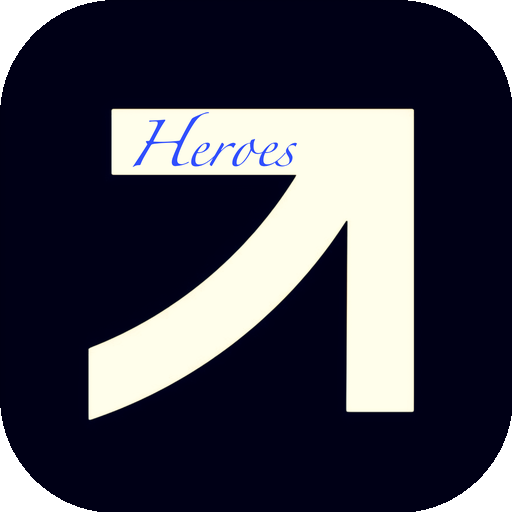

# Heros Player — Full YouTube Music Remote

### The fastest, most private, most beautiful remote for your browser's music.
### Detect everything - Control everything - Panel-only - 100% Local - Free - Unlimited

<br/>

[](./heros-player-extension/manifest.json)
[](https://developer.chrome.com/docs/extensions/mv3/)
[](./heros-player-extension/sidepanel.html)
[](#privacy-and-security)
[](#why-heros-player)
[](#themes-and-eye-comfort)

<br/>

[](#installation--30-seconds)
[](#installation--30-seconds)
[](#installation--30-seconds)
[](./LICENSE)
[](https://www.linkedin.com/in/ahmed-abo-bakr-1b2466288/)

**Website:** `https://ahmedbakr78.github.io/Heros_Music_Player/`  |  **Extension folder:** [`heros-player-extension/`](./heros-player-extension/)  |  **Issues:** [Report a bug](https://github.com/Ahmedbakr78/Heros_Music_Player/issues/new/choose)  |  **Feature request:** [Request it](https://github.com/Ahmedbakr78/Heros_Music_Player/issues/new/choose)

> **One-line description for the GitHub About box (copy-paste, no emojis):**
> `Heros Player — full remote for YouTube Music, YouTube, Spotify and any media tab. Live song readout, seek, volume, shuffle, repeat, likes. Panel-only, free and unlimited.`

</div>

---

## Table of Contents

- [Description (short, medium, long)](#description-short-medium-long)
- [Why Heros Player?](#why-heros-player)
- [Demo / How it looks](#demo--how-it-looks)
- [Feature Universe — The Complete List](#feature-universe--the-complete-list)
- [Heros Player vs Everyone Else](#heros-player-vs-everyone-else)
- [Architecture and Diagrams](#architecture-and-diagrams)
- [Data Flow and Remote Pipeline](#data-flow-and-remote-pipeline)
- [Probe Engine (herosProbe)](#probe-engine-herosprobe)
- [Act Engine (herosAct)](#act-engine-herosact)
- [Poll Loop and Freshness](#poll-loop-and-freshness)
- [Privacy and Security](#privacy-and-security)
- [Sequence Flows — End-to-End Journeys](#sequence-flows--end-to-end-journeys)
- [Error Handling and Resilience](#error-handling-and-resilience)
- [Accessibility](#accessibility)
- [Installation — 30 Seconds](#installation--30-seconds)
- [Usage Guide](#usage-guide)
- [Keyboard Shortcuts](#keyboard-shortcuts)
- [Remote Operations Handbook](#remote-operations-handbook)
- [Themes and Eye Comfort](#themes-and-eye-comfort)
- [Responsive and Panel-First](#responsive-and-panel-first)
- [Performance Engineering](#performance-engineering)
- [Design System and Visual Language](#design-system-and-visual-language)
- [Internals — Inside sidepanel.js](#internals--inside-sidepaneljs)
- [Release and Publishing Pipeline](#release-and-publishing-pipeline)
- [Contribution Workflow](#contribution-workflow)
- [Compatibility Matrix](#compatibility-matrix)
- [Project Stats](#project-stats)
- [Glossary](#glossary)
- [Repository Structure](#repository-structure)
- [Tech Stack](#tech-stack)
- [Roadmap](#roadmap)
- [Contributing](#contributing)
- [FAQ — 25 Questions](#faq--25-questions)
- [Changelog and Releases](#changelog-and-releases)
- [GitHub Topics, About and Website Setup](#github-topics-about-and-website-setup)
- [License and Credits](#license-and-credits)

---

## Description (short, medium, long)

Pick the length you need. All three are emoji-free and ready to paste into GitHub About, the website meta tags, or a store listing.

**Short (1 line, About box):**

```text
Heros Player — full remote for YouTube Music, YouTube, Spotify and any media tab. Live song readout, seek, volume, shuffle, repeat, likes. Panel-only, free and unlimited.
```

**Medium (1 paragraph, social shares):**

```text
Heros Player is a panel-only remote control for YouTube Music, YouTube,
Spotify, SoundCloud and any tab that plays media. It detects every sounding
tab and every music site on standby, then gives you the true song readout
(title, artist, album, cover), play/pause, next/previous, live seek, remote
volume, shuffle, repeat, likes, plus starred songs, history, timers and tab
surgery. Dark + Light, silent instant boot, 100% local. No account, no
tracking, no limits. Free forever (MIT).
```

**Long (full product description, website hero + store listing):**

```text
Heros Player turns the browser side panel into a full music remote. DETECT:
every audible tab found live (event-driven + auto-refresh), every music site
on standby (YouTube Music, YouTube, Spotify, SoundCloud, Apple Music, Deezer,
Tidal and more), deep scan that probes all tabs for hidden players, per-tab
state (playing / paused / sounding / muted), toolbar badge + header chip
counts. CONTROL: play/pause on the site's real buttons, next/previous that
keep queues and radios working, live seek bar with drag-to-jump, remote
volume slider + tab mute, shuffle, repeat off/all/one, thumbs up/down with
live pressed-state, playback speed 0.25x-2x with presets, nudge ±10s, pin +
follow-what-is-sounding, pause-all / mute-all / mute-by-site. YOURS: starred
songs, per-song notes, 100-deep history with JSON/TXT export, song search,
top-played ranking, listening time with daily goal, copy + find-anywhere.
CALM: sleep timer, fade-out timer, focus-25 with auto-resume, stop-after-song,
single-source mode, song-change OS notifications, per-site volume memory.
SURGERY: close others, close duplicates, pin/unpin, reload stuck player.
DESIGN: Heros tokens (floating cards, pill tabs, dark + light + 6 accents),
silent instant boot, full keyboard map, zero frameworks, zero network calls.
PRICE: free forever, unlimited everything, MIT open source. Browsers: Chrome,
Edge, Brave, Opera, Arc and any Chromium browser.
```

---

## Why Heros Player?

Switching tabs to pause music is friction. Floating mini-players are tiny and
dumb. Most "controller" extensions are plain-looking, paid, or phone home.

Heros Player is the opposite:

| Principle | What it means in practice |
|---|---|
| Full detection | Audible tabs + music-site standby + deep scan. Nothing sounding escapes the radar |
| True control | Real site buttons (queues keep working) + direct media driving (seek, volume, rate) |
| Careful design | Ultra-rounded floating cards, pill tabs, dark + light, icon-everywhere UI — the Heros language |
| 100 percent private | Tab state is read only to display and control it. No account, no tracking, no server |
| Free and unlimited | No tab limits, no "pro remote", no daily quota. Control 50 tabs if you want |
| Panel-native | Lives ONLY in the side panel. Toolbar, badge, menu — everything lands there |
| Power-user | Single-source, fade-out, stop-after-song, volume memory, tab surgery, history, goals |

---

## Demo / How it looks

> Real captures of the panel in dark theme. Shots live in `docs/screenshots/`
> (regenerate with `python3 /tmp/opencode/shots.py`, or replace 1:1 with
> captures from your own panel — same names).

| Control (remote hero + player bar) | Tabs (radar + standby) |
|---|---|
| 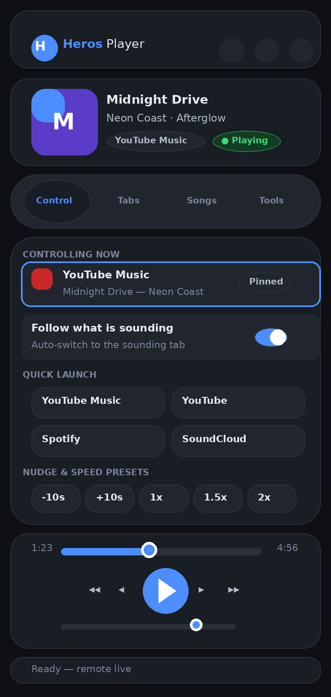 | 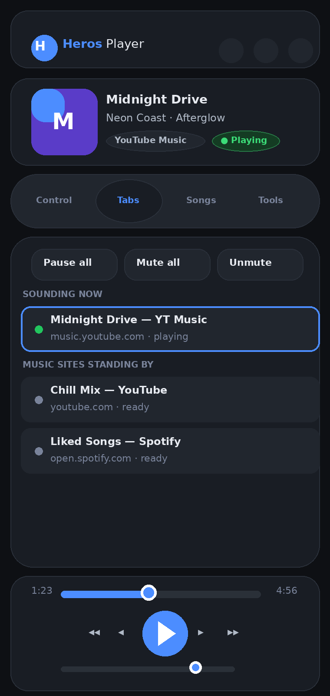 |

| Songs (starred + history + top) | Tools (timers + surgery) |
|---|---|
| 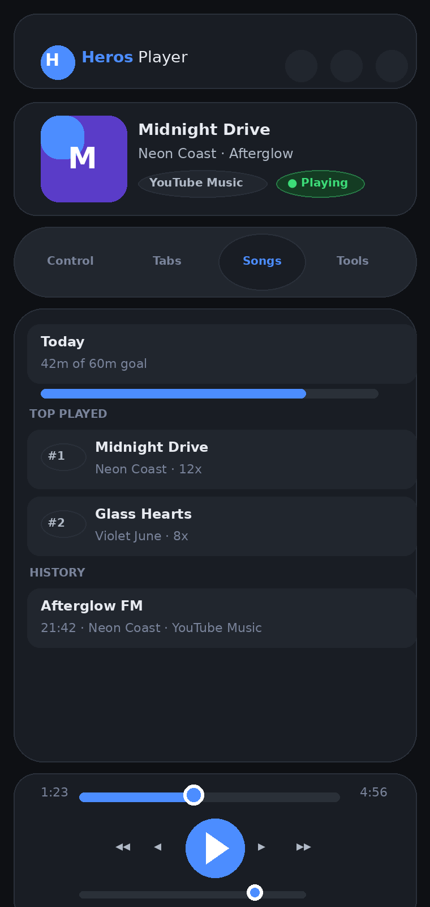 | 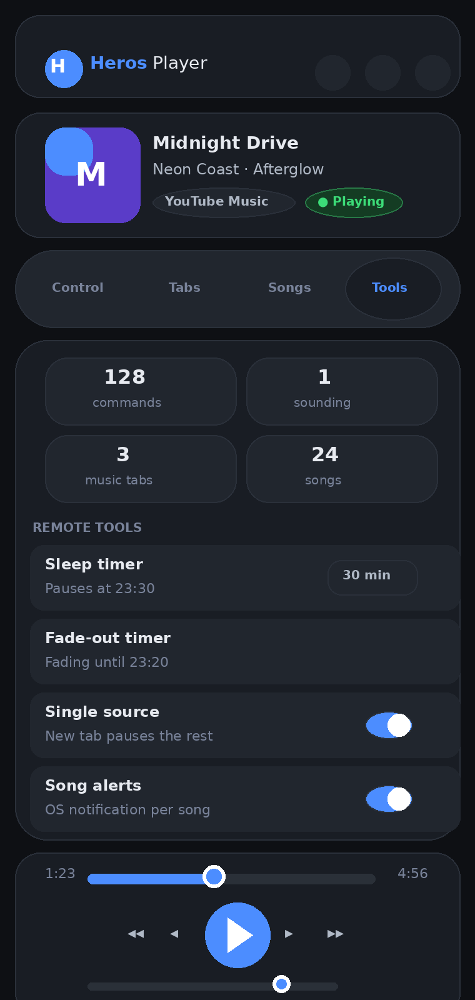 |

**Panel shell at a glance:**

```text
+---------------------------------------------------------------+
| Topbar (floating rounded card)                                |
| [Heros Player]                         [+Theme][Menu]         |
+---------------------------------------------------------------+
| Hero (floating card): cover + title + artist + site chips     |
+---------------------------------------------------------------+
| Pill tabs: [Control] [Tabs] [Songs] [Tools]                   |
+---------------------------------------------------------------+
| +-----------------------------------------------------------+ |
| | Card pane: target card / radar rows / songs / timers      | |
| +-----------------------------------------------------------+ |
+---------------------------------------------------------------+
| Player bar (floating card = THE REMOTE)                       |
| 1:23 [━━━━━━●━━━━━━] 4:56  [shuf][prev][PLAY][next][rep]     |
+---------------------------------------------------------------+
| Statusbar: Ready — remote live                                |
+---------------------------------------------------------------+
```

---

## Feature Universe — The Complete List

The printable checklist also lives in [`docs/FEATURES.md`](./docs/FEATURES.md).

### 1. Full detection
- [x] Every `audible` tab found live (event-driven + 4s refresh + lite sync)
- [x] Music-site standby: YouTube Music, YouTube, Spotify, SoundCloud, Apple Music, Deezer, Tidal, Bandcamp, Pandora, Audiomack, Mixcloud
- [x] Deep scan: probes up to 60 tabs for hidden `<audio>/<video>` players, with progress bar
- [x] Per-tab state: playing / paused / sounding / muted / standing by
- [x] Toolbar badge + header chip with sounding-tab count

### 2. Full control (per tab)
- [x] Play/Pause (real site button first, media-element fallback)
- [x] Next / Previous (real site buttons — queues, autoplay, radios keep working)
- [x] Seek to any second (drag the bar, ±10s nudge, arrow keys)
- [x] Remote volume 0–100 (slider, arrows, 25/50/75/100 presets)
- [x] Playback speed 0.25x–2x (fine slider + 0.5/1/1.5/2 presets)
- [x] Shuffle toggle, Repeat cycle, Thumbs up/down — live pressed-state readback
- [x] Tab mute/unmute, mute-by-site, go-to-tab, pin-to-control tab
- [x] Pin/unpin browser tab, reload stuck player, pop the player to its own window

### 3. Controller UX
- [x] Hero card: cover art, title, artist, album, site chip, playing chip — click cover to jump
- [x] Follow-what-is-sounding auto-switch + one-tap quick launchers
- [x] Poll speed Turbo 0.5s / Normal 1s / Calm 2s
- [x] Per-site volume memory with auto-restore on site switch

### 4. Yours: songs, history, stats
- [x] Star any song (`F`), per-song notes, Starred list with find/unstar
- [x] 100-deep history with timestamp + site, JSON + TXT export
- [x] Song filter search, Top-played auto ranking
- [x] Listening time (total + today) with daily-goal progress bar
- [x] Copy `Title — Artist` (`C`), Find-anywhere on YouTube Music

### 5. Calm: timers and modes
- [x] Sleep timer 5–120 min (pause or duck-fade)
- [x] Fade-out timer 5–30 min (volume glides to zero, then pauses)
- [x] Focus 25m (pause now, auto-resume after)
- [x] Stop-after-this-song (auto-pause on track change)
- [x] Single-source mode (a newly sounding tab pauses the rest)
- [x] Song-change OS notifications (toggleable)

### 6. Tab surgery + power
- [x] Pause ALL / Mute ALL / Unmute ALL
- [x] Close others (keep controlled, with confirm), Close duplicates
- [x] Command counter, songs-seen counter, sounding/sites stats
- [x] Prefs export / import / reset

### 7. Free power — no limits
- [x] No accounts, no paywall, no "pro remote", no daily quota
- [x] Unlimited tabs, unlimited history, unlimited stars
- [x] Works offline after install (zero network calls by design)

---

## Heros Player vs Everyone Else

| Capability | Heros Player | Tab mute button | Typical "controller" extension |
|---|---|---|---|
| Auto-detects all sounding tabs | Yes, + standby + deep scan | No | Partial |
| True song + cover readout | Yes (MediaSession + YTM DOM) | No | Partial, often wrong |
| Next/Prev keeping queues alive | Yes, real buttons | No | Sometimes |
| Live seek + remote volume | Yes | No | Rare |
| Shuffle / Repeat / Likes w/ state | Yes | No | Rare |
| History, stars, goals, timers | Yes | No | No |
| 100 percent local | Yes | Yes | Often phones home |
| Price | Free forever | Free | Freemium |

---

## Architecture and Diagrams

### Diagram 1 — System overview

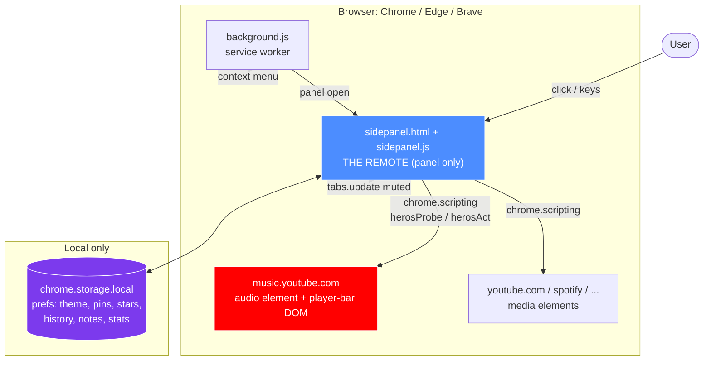

### Diagram 2 — Folder map

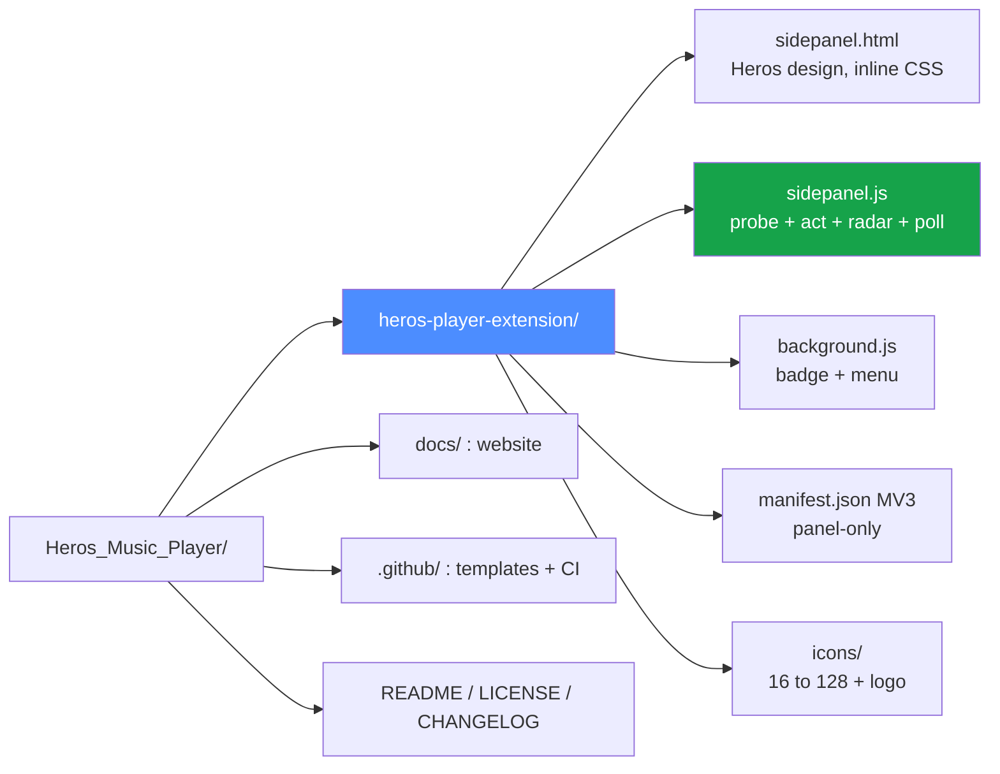

### Diagram 3 — Extension lifecycle (install to first remote)

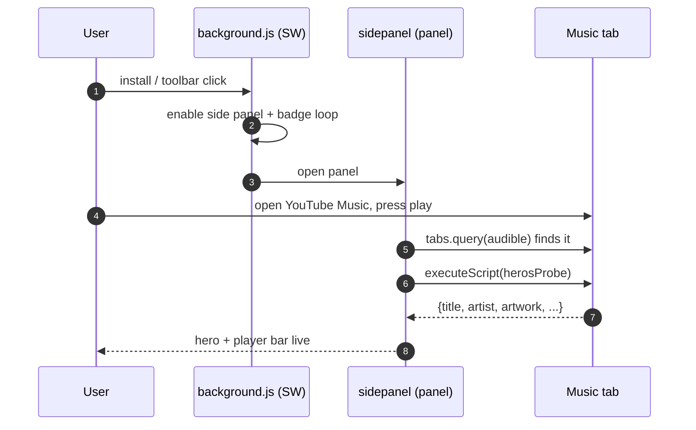

### Diagram 4 — Privacy (nothing leaves the device)

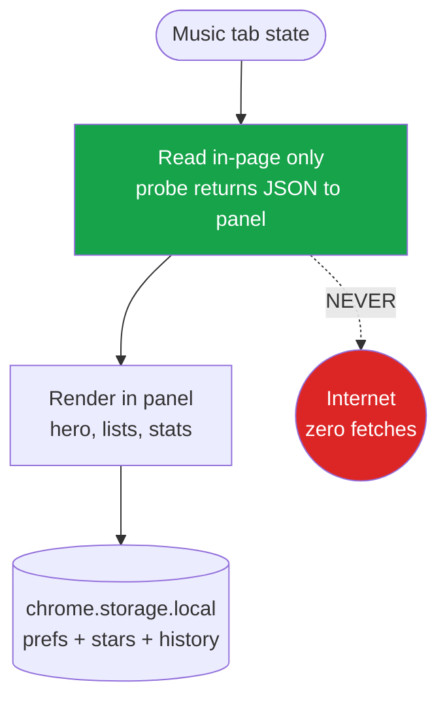

---

## Data Flow and Remote Pipeline

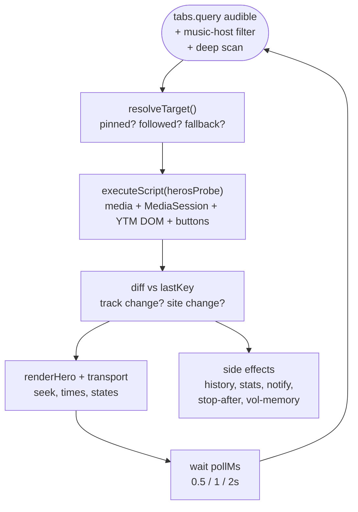

**Key engineering decisions (why it is fast):**

1. **Single-flight polling** — one probe at a time; slow tabs never stack requests.
2. **Cheap lite sync** — the 4s radar tick only re-queries `audible`, full probes stay on the sounding set.
3. **Capped everything** — 8 live probes per radar pass, 60 tabs per deep scan, 300-row lists, 100-deep history.
4. **No frameworks** — vanilla DOM writes, no virtual-DOM tax in a 350px panel.
5. **Silent boot** — boot class kills first-paint animations; panel is interactive in milliseconds.
6. **Real buttons first** — next/prev/like click the site's own controls, so site state machines (queue, radio) never desync.

---

## Probe Engine (herosProbe)

The injected, self-contained function. No closures — it serializes into any page.

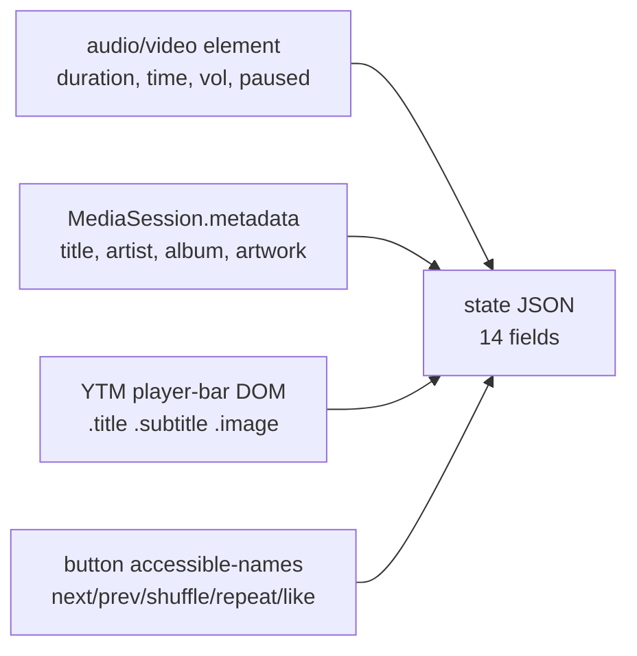

Field table (all reads, zero writes):

| Field | Source | Fallback |
|---|---|---|
| `playing` | `!media.paused && !media.ended` | `false` |
| `title` / `artist` / `album` | MediaSession → YTM DOM | `document.title` parse |
| `artwork` | `metadata.artwork[last]` → YTM `.image` | letter cover |
| `duration` / `currentTime` | media element | `0` |
| `volume` / `muted` / `rate` | media element | `1 / false / 1` |
| `hasNext` / `hasPrev` | buttons matching `/^next/i` etc. | `false` |
| `shuffle` / `repeat` / `like` / `dislike` | `aria-pressed` + label text | `null` (button dims) |

---

## Act Engine (herosAct)

One function, nine verbs. Real site buttons first, media-element fallback second.

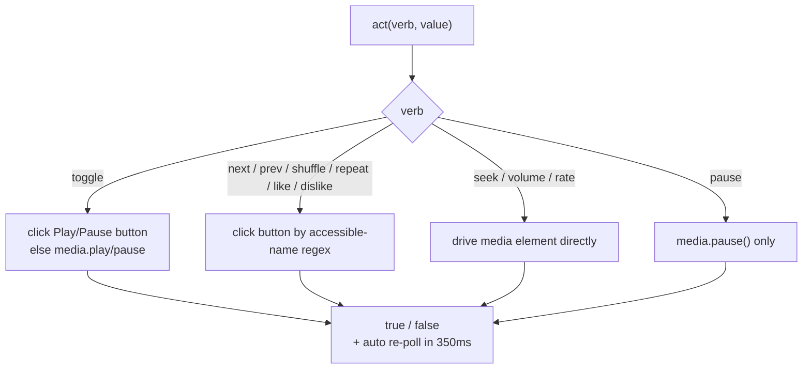

**Remote operations handbook:**

| Verb | Arg | Returns false when | Notes |
|---|---|---|---|
| `toggle` | — | no button and no media | Space, player button, badge menu |
| `next` / `prev` | — | site has no such button | Toast explains; queue preserved |
| `seek` | seconds | no duration yet | Clamped to `[0, duration-0.25]` |
| `volume` | 0–1 | no media | Also unmutes the element |
| `rate` | 0.25–2 | — | Pitch handled by the site |
| `shuffle` / `repeat` / `like` / `dislike` | — | button missing | State re-read on next poll |
| `pause` | — | — | Sleep, focus, single-source, stop-after |

---

## Poll Loop and Freshness

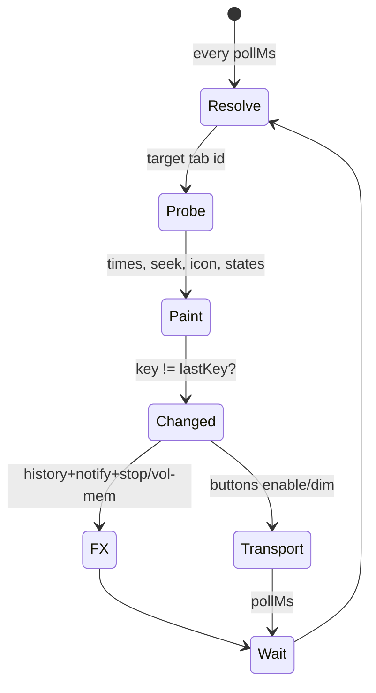

Freshness budget: Turbo 0.5s (~2 probes/s on one tab), Normal 1s, Calm 2s.
Seeking sets a drag flag so the poll never fights the user's thumb.

---

## Privacy and Security

- **No servers, no analytics, no accounts.** See [`SECURITY.md`](./SECURITY.md).
- Permissions: `sidePanel` (the home), `tabs` (find + mute + pin), `scripting` (probe/act), `storage` (prefs), `contextMenus`, `tabCapture` (reserved for future loudness work), `notifications` (song alerts only). `<all_urls>` lets the probe run on any music site — it reads player state, never page content.
- To report a vulnerability, see [`SECURITY.md`](./SECURITY.md) — please do not open a public issue.

Threat model in one table:

| Asset | Where it lives | Who can see it |
|---|---|---|
| Tab player state | Memory, panel only | Only you |
| Stars, notes, history, stats | `chrome.storage.local`, your profile only | Only you |
| Preferences | `chrome.storage.local`, your profile only | Only you |
| Network | Zero fetches by design | Nobody |

---

## Sequence Flows — End-to-End Journeys

### Flow 1 — First detection of YouTube Music

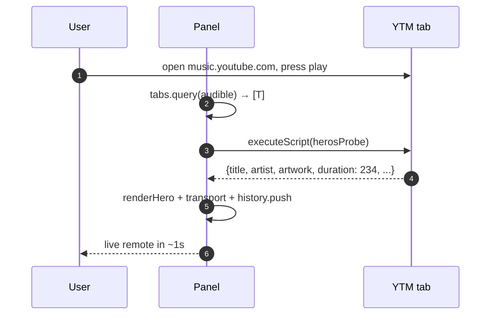

### Flow 2 — Seeking without fighting the poll

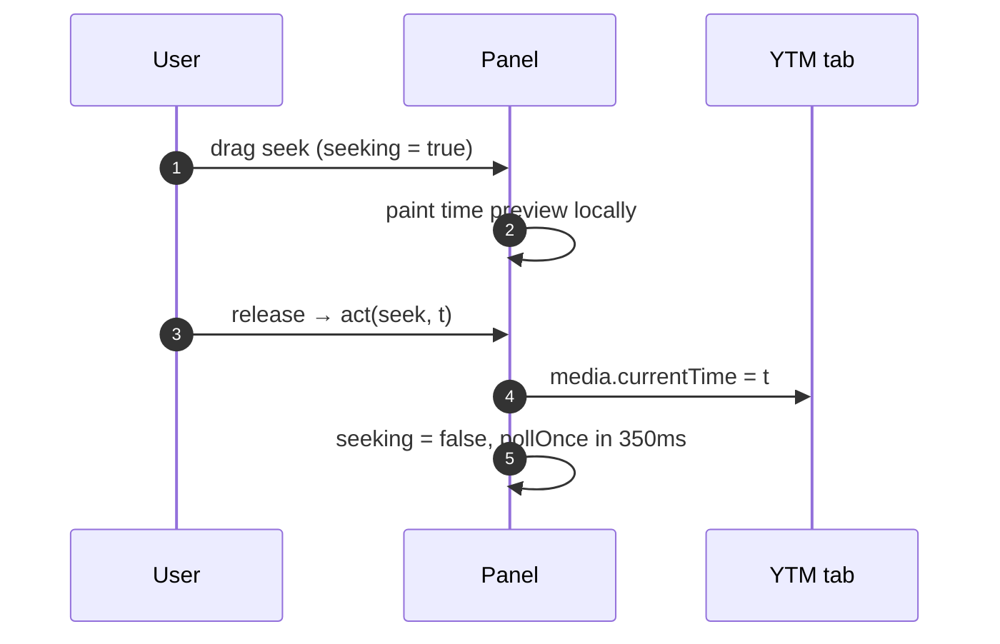

### Flow 3 — Single-source auto-pause

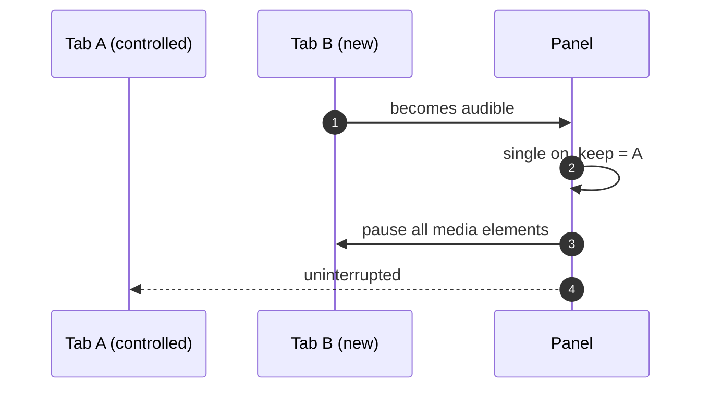

### Flow 4 — Stop-after-this-song

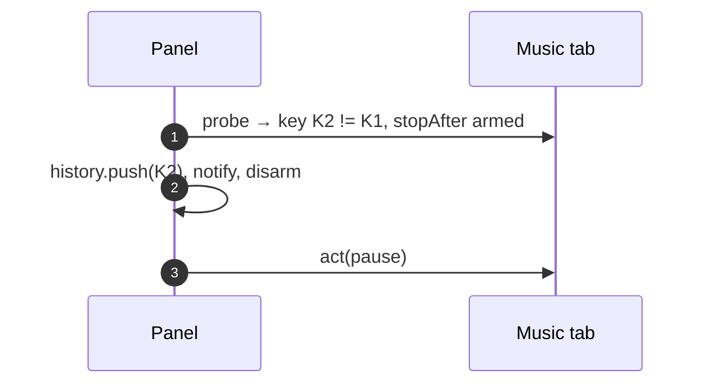

### Flow 5 — Deep scan uncovering a hidden player

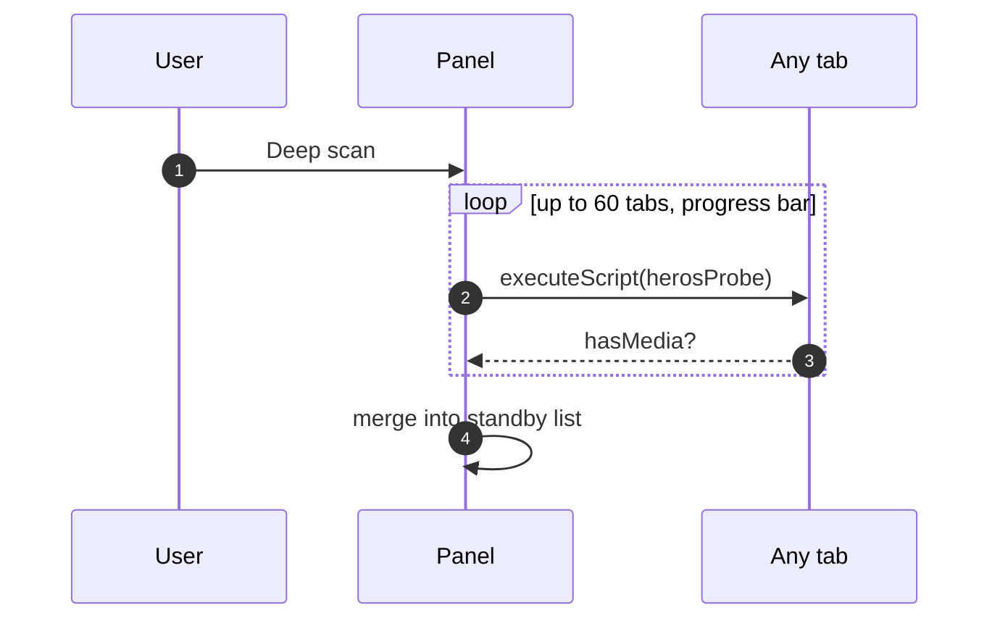

---

## Error Handling and Resilience

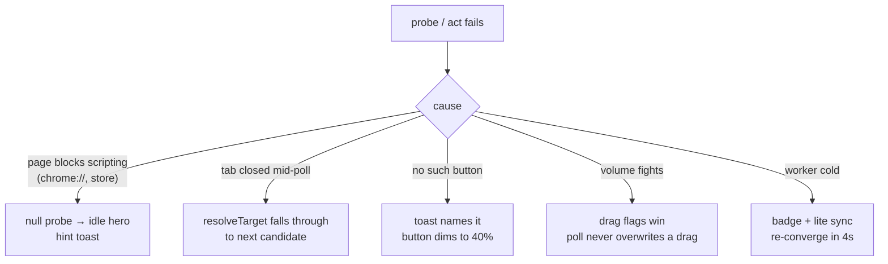

Guarantees: no dead buttons (every action toasts on failure), no stacked
polls, no accounts to lose, prefs writes debounced and idempotent.

---

## Accessibility

- Fully keyboard-operable (map in-app via Menu and below).
- `:focus-visible` rings, logical tab order, `aria-label`s on icon buttons.
- `prefers-reduced-motion` collapses animation.
- Contrast-tuned tokens per theme; 32px+ hit targets in the narrow panel.

---

## Installation — 30 Seconds

Works in Chrome, Edge, Brave, Opera, Arc, Vivaldi — any Chromium browser.

```bash
# 1. Get the code
git clone https://github.com/Ahmedbakr78/Heros_Music_Player.git
cd Heros_Music_Player

# 2. Open YOUR browser's extensions page (table below)
# 3. Enable Developer mode
# 4. Load unpacked → select:
#    Heros_Music_Player/heros-player-extension/
# 5. Click the Heros Player toolbar icon → the SIDE PANEL opens. Done!
```

| Browser | Extensions page |
|---|---|
| Google Chrome | `chrome://extensions` |
| Microsoft Edge | `edge://extensions` |
| Brave | `brave://extensions` |
| Opera / Arc / Vivaldi | `opera://`, `arc://`, `vivaldi://extensions` |

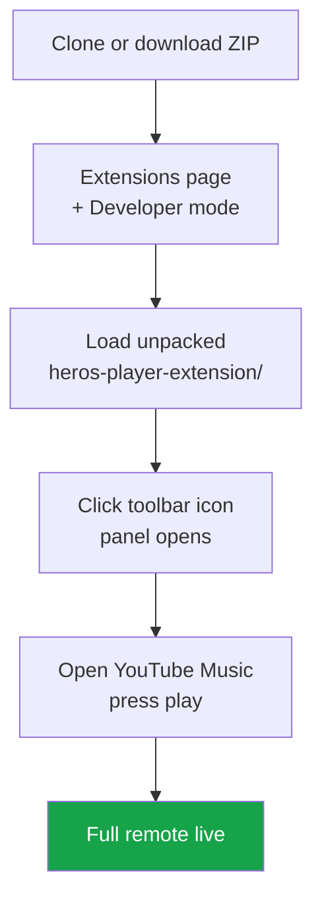

Full illustrated guide: [`docs/INSTALLATION.md`](./docs/INSTALLATION.md).

---

## Usage Guide

| I want to… | How |
|---|---|
| Control YouTube Music | Open it, press play — panel takes over in ~1s |
| Play / Pause | Big button, `Space`, or right-click → Play/Pause |
| Next / Previous | Buttons or `N` / `P` |
| Seek | Drag bar, `←`/`→` ±10s, or ±10s buttons |
| Volume | Slider, `↑`/`↓`, or 25/50/75/100 presets |
| Mute the tab | `M` or speaker button; Mute-site mutes all of them |
| Shuffle / Repeat / Like | Buttons (live state) or `L` for like |
| Star a song | `F` — lives in Songs forever |
| Copy song text | `C` |
| Pin one tab | Control button on its radar row (disables Follow) |
| Silence everything | Pause all / Mute all |
| Sleep / fade / focus | Tools tab timers |
| Find hidden players | Tabs → Deep scan |
| Clean up | Close others / Close duplicates |

Long version: [`docs/USER_GUIDE.md`](./docs/USER_GUIDE.md).

---

## Keyboard Shortcuts

| Keys | Action | Keys | Action |
|---|---|---|---|
| Space | Play / Pause remote | ← / → | Seek ∓10s |
| ↑ / ↓ | Remote volume | N / P | Next / Previous |
| M | Mute tab | L | Like (site) |
| F | Star song | C | Copy song |
| 1–4 | Switch panes | Esc | Blur input |

---

## Remote Operations Handbook

See [Act Engine](#act-engine-herosact) — the nine verbs, their args, and their
failure modes in one table.

---

## Themes and Eye Comfort

| Mode | UI | When to use |
|---|---|---|
| Light | White surfaces, blue accent | Daytime |
| Dark (default) | Dark surfaces, bright blue accent | Night work, OLED |

Toggle instantly with the moon/sun button; 6 accent presets + custom color in
Menu. Persisted in `chrome.storage.local`.

---

## Responsive and Panel-First

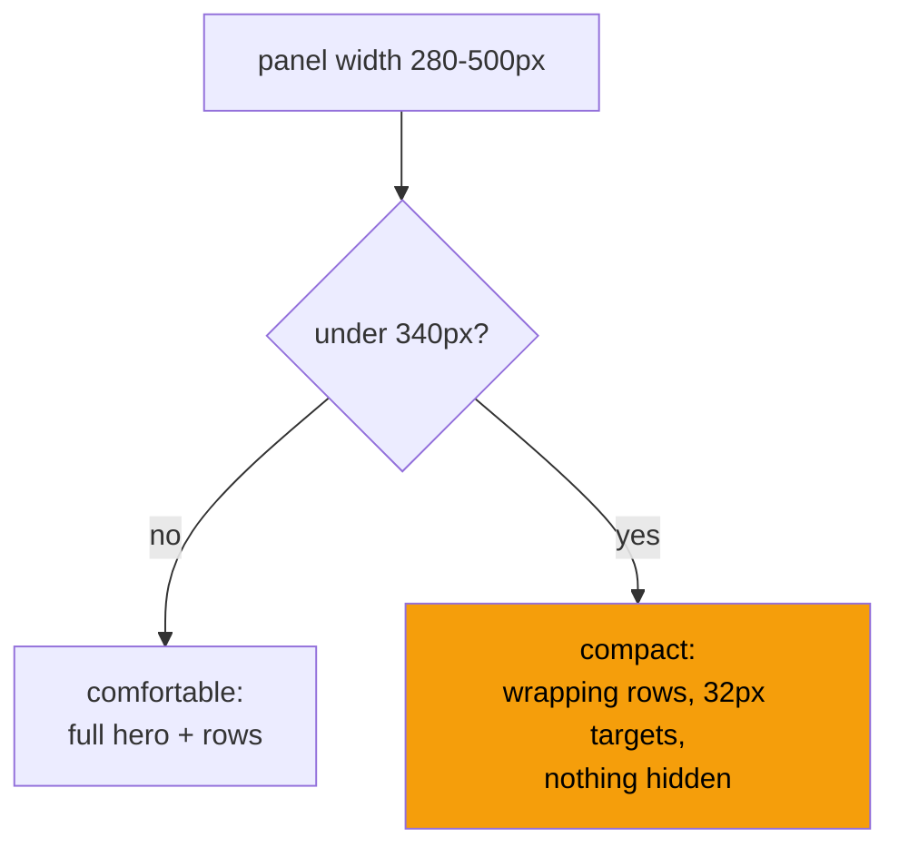

The panel is the only surface — every feature is reachable at 280px. No
hover-only affordances; scrollbars hidden app-wide (scrolling still works).

---

## Performance Engineering

| Technique | Where | Effect |
|---|---|---|
| Single-flight polling | `pollOnce()` | Slow tabs never stack requests |
| Lite radar sync | 4s interval | Badge/chips live without probes |
| Capped probes | radar 8, scan 60 | No tab-storm on big sessions |
| Capped lists/history | renderers | Constant-time paint |
| Drag flags | seek/vol | Poll never fights the user |
| Silent boot | boot class | Instant first paint |
| Debounced inputs | search, prefs | No write spam |

Budgets: boot under 300ms; one scripting round-trip per second per
controlled tab; zero jank on seek drags.

---

## Design System and Visual Language

Mirrored 1:1 from Heros PDF — same tokens, same contract, zero drift.

| Token family | Light | Dark | Notes |
|---|---|---|---|
| Surfaces | `#ffffff`, `#f3f5f8`, `#e8ebf0` | `#191d24`, `#21262e`, `#2a3038` | Card, control, raised |
| Text | `#14181f`, `#4a5568`, `#7b8697` | `#e7eaf0`, `#b0b9c6`, `#79839a` | Primary, secondary, muted |
| Accent | `#2563eb` | `#4c8dff` | 6 presets + custom |
| Radii | 20 / 14 / 11 / 7 px + 999px pill | same | Cards → pills |
| Elevation | sm / md / lg | same | Panel cards use lg |

Roundness contract: topbar / playerbar 20px · panes 26px · tabs pill ·
rows 11px · chips pill · modal 22px · toasts 14px.

---

## Internals — Inside sidepanel.js

One dependency-free script in numbered sections:

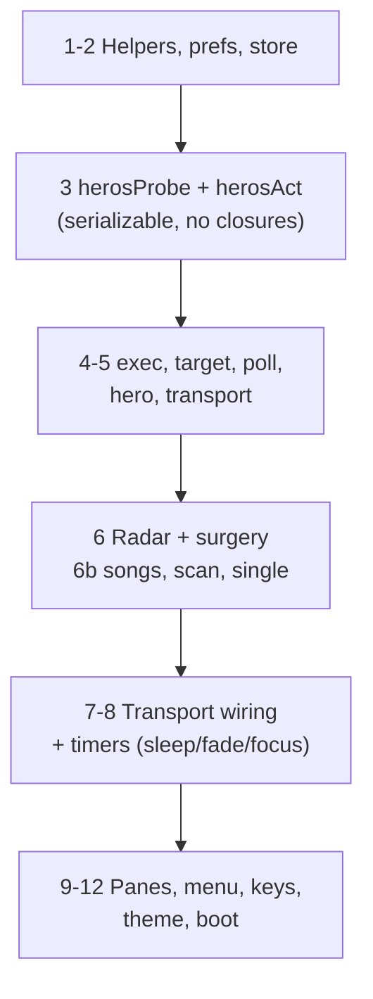

Key invariants (enforced by review):

1. Injected functions reference no outer scope — they must survive serialization.
2. The poll never overwrites an active drag (`seeking`, `volDrag`).
3. Every `chrome.*` call is guarded — the panel degrades to helpful hints, never a blank card.
4. Nothing leaves the device: no `fetch` anywhere in the codebase.

---

## Release and Publishing Pipeline

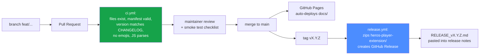

Versioning: SemVer. `patch` = fixes, `minor` = features, `major` = breaking
or manifest break. Manifest version, CHANGELOG top entry, and tag must agree.

---

## Contribution Workflow

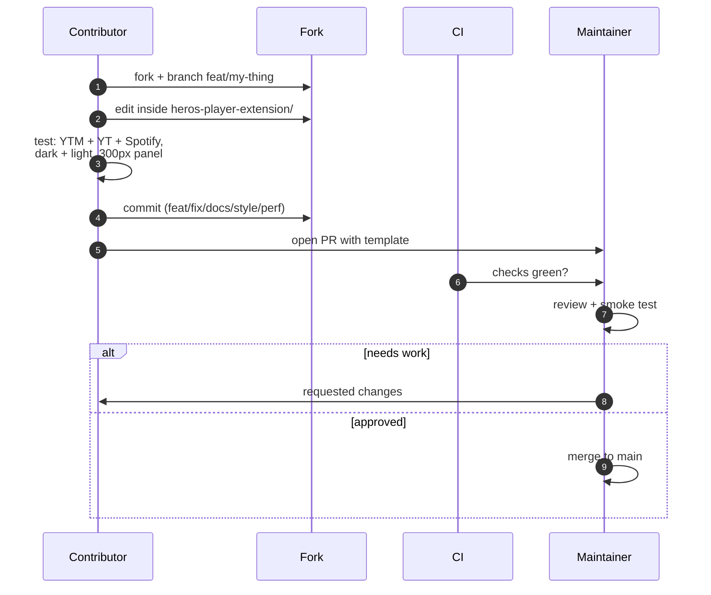

Rules: one logical change per PR, no new permissions without an issue first,
no frameworks or bundlers, no network calls. See [`CONTRIBUTING.md`](./CONTRIBUTING.md).

---

## Compatibility Matrix

| Platform | Status | Notes |
|---|---|---|
| Chrome (MV3) | Supported | Reference target |
| Edge / Brave / Opera / Arc / Vivaldi | Supported | Same flow, different extensions URL |
| YouTube Music | Full | Probe + all 9 verbs + thumbs |
| YouTube / Spotify / SoundCloud | Full | MediaSession + media path |
| Any media tab | Full | Generic probe + act |
| Firefox | Roadmap | Needs MV2-compatible port |
| Chrome Web Store | Roadmap | Packaged release + listing |
| Offline | Full | Zero runtime fetches |

---

## Project Stats

| Metric | Value |
|---|---|
| Panel engine | ~870 lines JS + ~330 lines HTML/CSS |
| Background worker | ~110 lines |
| Documentation | README + 5 docs pages + this table |
| Diagrams in README | 16 (all mermaid, reproducible anywhere) |
| Features shipped | 40+ (see `docs/FEATURES.md`) |
| Permissions requested | 7 (`sidePanel`, `storage`, `tabs`, `tabCapture`, `scripting`, `contextMenus`, `notifications`) |
| Runtime dependencies | None — zero frameworks, zero build step |
| Emojis in repo docs | 0 (enforced by CI) |

---

## Glossary

| Term | Meaning |
|---|---|
| Panel-only | The app has no popup and no full-page view; everything lives in `side_panel`. |
| Probe | `herosProbe()` — the injected read-only state reader. Returns 14-field JSON. |
| Act | `herosAct(verb, value)` — the injected nine-verb remote writer. |
| Controlled tab | The single tab the hero + player bar currently drive. |
| Follow | Mode that auto-switches the controlled tab to whatever is sounding. |
| Pin (control) | Locking the controlled tab so Follow never steals it. |
| Radar | The sounding + standby tab lists with live states. |
| Deep scan | Throttled probe of up to 60 tabs to find hidden players. |
| Single-source | Mode that pauses all other sounding tabs automatically. |
| Lite sync | Cheap 4s `audible` re-query that keeps badge/chips fresh without probes. |
| MediaSession | The browser API sites use to publish title/artist/artwork — our first readout source. |
| Accessible-name | A button's `aria-label`/`title` — how we find Next/Play/Like on any site. |

---

## Repository Structure

```text
Heros_Music_Player/
├── README.md                        ← you are here (the big one)
├── LICENSE                          ← MIT
├── CHANGELOG.md                     ← every version, newest first
├── CONTRIBUTING.md                  ← how to help
├── CODE_OF_CONDUCT.md               ← be kind
├── SECURITY.md                      ← report vulnerabilities privately
├── SUPPORT.md                       ← where to get help
├── REPO_META.md                     ← About box, topics, website setup
├── RELEASE_v1.1.0.md                ← release notes for the tag
├── heros-player-v1.1.0.zip          ← packaged extension (store-ready)
├── _config.yml                      ← GitHub Pages settings (docs/ site)
│
├── heros-player-extension/          ← THE EXTENSION (load this folder unpacked)
│   ├── manifest.json                ← MV3, v1.1.0, panel-only
│   ├── sidepanel.html               ← Heros design (inline CSS, zero deps)
│   ├── sidepanel.js                 ← probe + act + radar + poll engine
│   ├── background.js                ← badge, context menu, panel opener
│   └── icons/                       ← 16→128 + logo (mirrored set)
│
├── docs/                            ← WEBSITE (GitHub Pages serves this)
│   ├── index.md                     ← home
│   ├── INSTALLATION.md              ← illustrated install
│   ├── USER_GUIDE.md                ← full usage guide
│   ├── FEATURES.md                  ← printable checklist
│   ├── DIAGRAMS.md                  ← diagram gallery
│   ├── PRIVACY.md                   ← privacy deep-dive
│   └── screenshots/                 ← control/tabs/songs/tools.png
│
└── .github/
    ├── ISSUE_TEMPLATE/
    │   ├── bug_report.md
    │   └── feature_request.md
    ├── PULL_REQUEST_TEMPLATE.md
    └── workflows/
        ├── ci.yml                   ← files, manifest, version, emojis, JS parse
        └── release.yml              ← zip + GitHub Release on tags
```

---

## Tech Stack

| Layer | Choice | Why |
|---|---|---|
| Platform | Chrome MV3, `side_panel` | Panel-native, service-worker background |
| Remote reads | `chrome.scripting` + MediaSession + DOM | Works on every music site, no per-site API keys |
| Remote writes | Button clicks + media-element driving | Queues stay alive; seek/vol/rate direct |
| Persistence | `chrome.storage.local` (+ localStorage fallback) | Private, offline, debounced |
| UI | Vanilla HTML/CSS/JS, inline | Instant boot, zero dependencies |
| Docs site | GitHub Pages + Jekyll (`docs/`) | Free hosting, versioned with code |
| CI/CD | GitHub Actions | Checks + releases on tag push |

---

## Roadmap

- [ ] v1.2 — Queue peek (read the site's up-next where exposed), per-song play counts
- [ ] v1.3 — Firefox MV2-compatible port
- [ ] v1.4 — Chrome Web Store + Edge Add-ons listings
- [ ] v2.0 — Optional loudness toolkit via `tabCapture` (off by default, permission-gated)
- [ ] Always — more sites verified, faster polls, smaller paint

Vote and propose: [Feature request](https://github.com/Ahmedbakr78/Heros_Music_Player/issues/new/choose).

---

## Contributing

One logical change per PR, tested on YouTube Music + one more site, dark +
light, 300px panel. Full guide: [`CONTRIBUTING.md`](./CONTRIBUTING.md).
Be kind: [`CODE_OF_CONDUCT.md`](./CODE_OF_CONDUCT.md).

---

## FAQ — 25 Questions

**Install & setup**
1. *Which browsers work?* Any current Chromium: Chrome, Edge, Brave, Opera, Arc, Vivaldi.
2. *How do I install?* Extensions page → Developer mode → Load unpacked → pick `heros-player-extension/`. [Guide](./docs/INSTALLATION.md).
3. *The icon does nothing?* It opens the side panel — the whole app lives there. If no panel appears, reload the extension.
4. *Firefox?* Roadmap (needs an MV2-compatible port).
5. *Is it in the Chrome Web Store?* Roadmap — for now, load unpacked (30 seconds).

**Detection**
6. *It says "Nothing detected"?* Open a music site and press play — detection follows sound, usually within a second.
7. *Does it work on Spotify / SoundCloud?* Yes — anything with a media element or MediaSession.
8. *A player is open but paused — is it found?* Yes if it's a known music site (standby list) or via Deep scan.
9. *What is Deep scan?* A throttled probe of all your tabs that finds hidden players. Tabs → Deep scan.
10. *Why does the badge show a number?* That's how many tabs are sounding right now.

**Control**
11. *Does Next break my YouTube Music queue?* No — it clicks the site's real Next button, so queue/radio continue.
12. *Seek doesn't move?* The track may be a live stream (no duration) — the bar then shows elapsed only.
13. *Like button is dimmed?* The site exposes no like control there (e.g. plain `<video>` pages).
14. *Volume slider does nothing?* DRM/live pages can block scripting — try tab mute (`M`) instead.
15. *Can I control two tabs at once?* One controlled tab at a time — pin it, or let Follow chase the sound. Pause-all covers the rest.

**Data & privacy**
16. *Do my songs upload anywhere?* No. Zero network calls. History lives in `chrome.storage.local`.
17. *How do I wipe everything?* Tools → Reset, or remove the extension.
18. *How do I back up?* Tools → Export prefs (stars, history, notes, stats included).

**Timers & modes**
19. *Sleep vs Fade-out?* Sleep pauses at the deadline; Fade-out glides the volume down first.
20. *Stop-after-this-song?* Arms a one-shot pause on the next track change.
21. *Single-source?* Newly sounding tabs get auto-paused so only your controlled tab plays.

**Troubleshooting**
22. *Panel is blank after update?* Reload the extension on `chrome://extensions`, then reopen the panel.
23. *"Tab blocked this action"?* Protected pages (`chrome://`, web store) forbid scripting — control those tabs directly.
24. *Something looks broken after a site redesign?* Report it — the probe reads DOM labels that sites occasionally rename. [Bug report](https://github.com/Ahmedbakr78/Heros_Music_Player/issues/new/choose).
25. *Where do I ask for a feature?* [Feature request](https://github.com/Ahmedbakr78/Heros_Music_Player/issues/new/choose) — one idea per issue.

---

## Changelog and Releases

- [`CHANGELOG.md`](./CHANGELOG.md) — every version, newest first.
- [`RELEASE_v1.1.0.md`](./RELEASE_v1.1.0.md) — notes for the current tag.
- [`heros-player-v1.1.0.zip`](./heros-player-v1.1.0.zip) — packaged extension, also attached to the GitHub Release.

---

## GitHub Topics, About and Website Setup

Copy-paste kit lives in [`REPO_META.md`](./REPO_META.md): the About description,
20 topics, the website URL, and the social-preview + Pages checklist. The docs
site (`docs/`) deploys to `https://ahmedbakr78.github.io/Heros_Music_Player/`
automatically via Pages.

---

## License and Credits

MIT — see [`LICENSE`](./LICENSE). Free forever, unlimited everything.

- Author: **Ahmed ABOBAKR (Ahmedbakr78)** — [LinkedIn](https://www.linkedin.com/in/ahmed-abo-bakr-1b2466288/)
- Design language mirrored from **Heros PDF** (same author, MIT) — sources never modified.
- Built with vanilla web tech: no frameworks, no bundlers, no servers.
- Thanks to every tester who pressed play.
