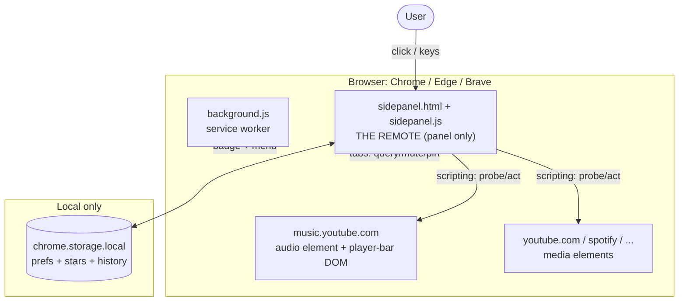
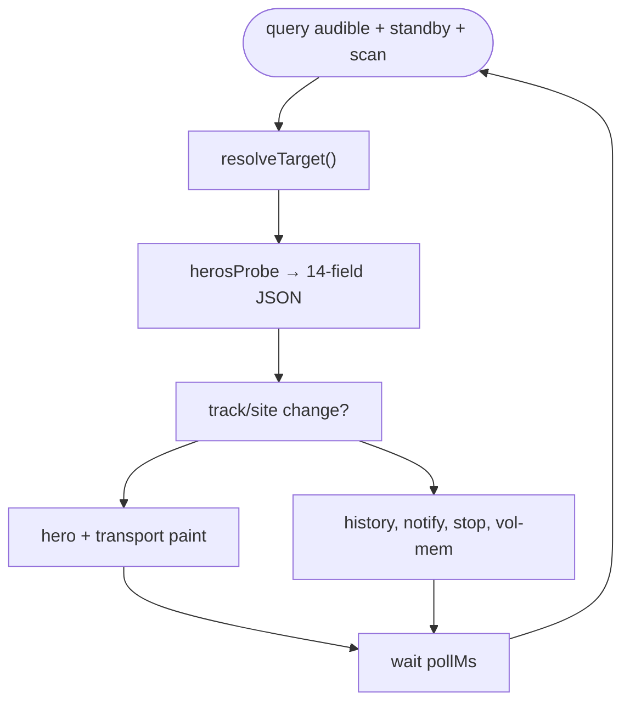
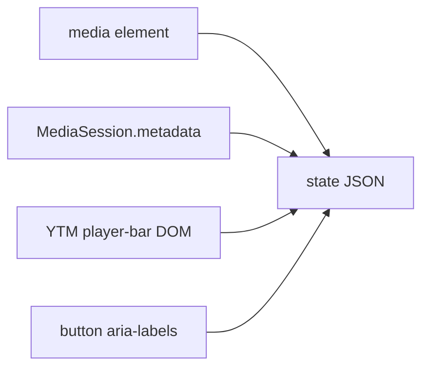
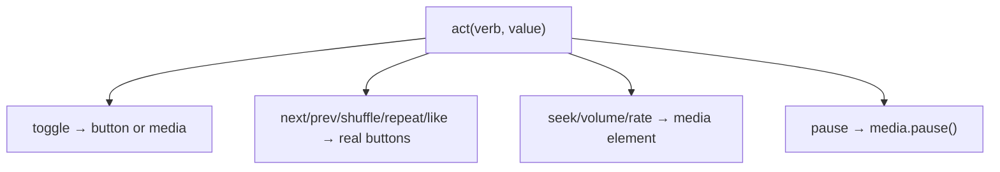
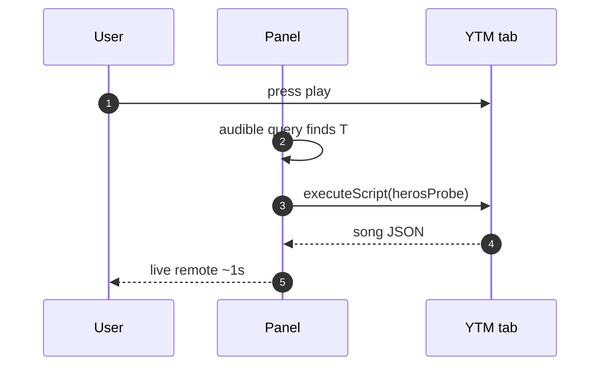
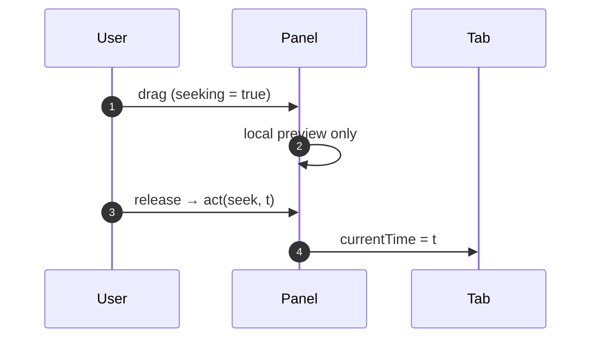
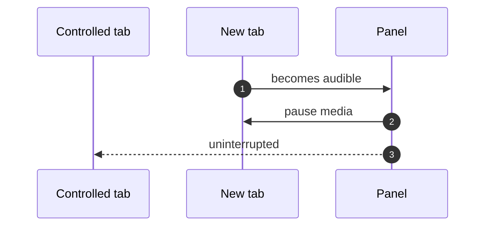
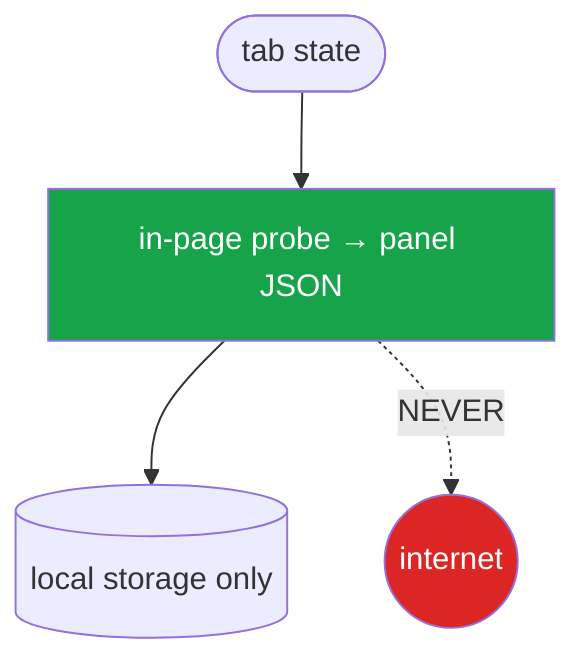
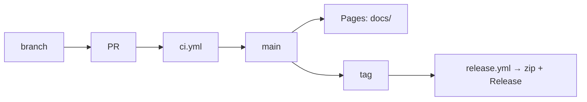

# Diagrams — the whole system on one page

Every diagram is Mermaid — renders on GitHub, the Pages site, and any modern
Markdown viewer. Sources of truth live in `README.md`; this page is the
gallery.

## 1. System overview

## 2. Remote pipeline (poll loop)

## 3. Probe engine

## 4. Act engine (nine verbs)

## 5. First detection

## 6. Seek without fighting the poll

## 7. Single-source auto-pause

## 8. Privacy boundary

## 9. Release pipeline

